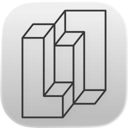
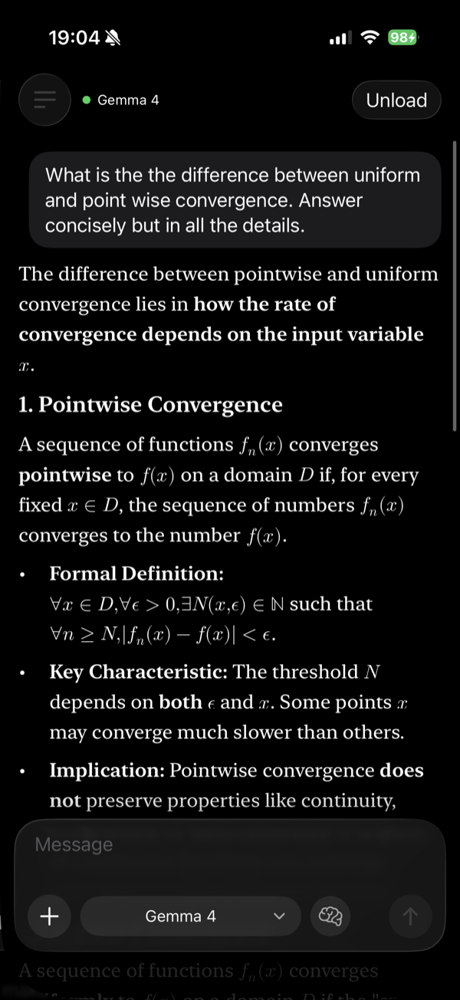
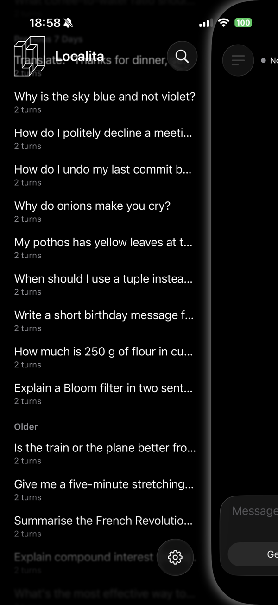
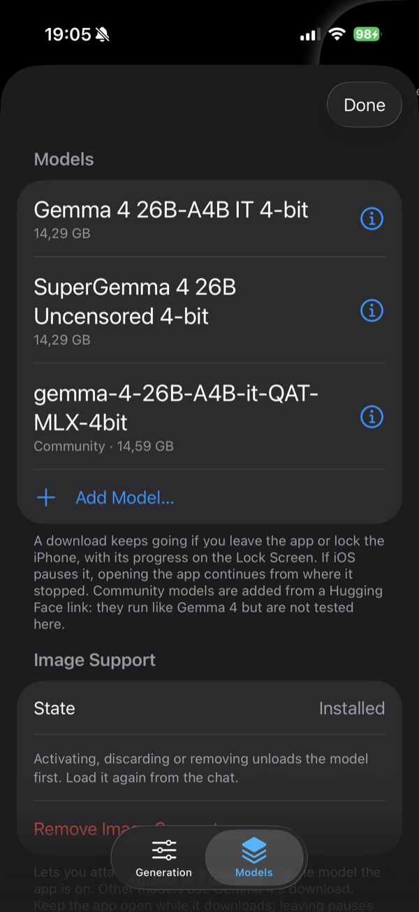

<p align="center">
  <picture>
    <source media="(prefers-color-scheme: dark)" srcset="docs/assets/localita-icon-dark.png">
    
  </picture>
</p>

<h1 align="center">Localita</h1>

<p align="center">
  <strong>A 26-billion-parameter AI model that runs entirely on your iPhone.</strong>
</p>

<p align="center">
  
  
  
  <a href="LICENSE"></a>
</p>

<p align="center">
  <a href="#what-it-does">What it does</a> ·
  <a href="#how-fast-is-it">Speed</a> ·
  <a href="#how-it-fits-on-a-phone">How it works</a> ·
  <a href="#what-this-project-adds">What this project adds</a> ·
  <a href="#whats-next">What's next</a> ·
  <a href="#privacy">Privacy</a> ·
  <a href="#build-it">Build it</a> ·
  <a href="#credits-and-license">Credits</a>
</p>

Localita is an offline chat app for iPhone built around Google's
[Gemma 4 26B-A4B](https://ai.google.dev/gemma/docs/core/model_card_4). The
model runs on the phone itself. What you type and the photos you share never
leave it, and once the model is downloaded the app works without a connection.

> [!NOTE]
> Localita is not on TestFlight or the App Store yet. For now, you build it
> from source (see [Build it](#build-it)). It has been developed and tested on
> one phone, an iPhone 17.

<p align="center">
  
  
  
</p>

## What it does

- **Chat with Gemma 4.** Your conversations stay on the phone. Replies render
  Markdown, code, tables and math.
- **Ask about photos.** An optional image pack (about 1.1 GB) lets the model
  read pictures you attach.
- **Keeps going when you switch apps.** Leave mid-reply and it continues in a
  small Picture in Picture window. Locking the phone pauses it, and it resumes
  when you unlock. You can turn this off in Settings.
- **One download, about 15 GB.** It uses Wi-Fi unless you allow mobile data,
  continues in the background, and resumes if it stops.
- **Other builds of the model.** Besides Google's model, you can install
  SuperGemma 4 (a community edit) or paste a Hugging Face link to another
  Gemma 4 26B-A4B build with the same layout, such as the QAT and LM Studio
  versions. The app checks the layout before downloading and pins the exact
  revision it checked.
- **Settings for the model and the engine.** Temperature, top-K and top-P,
  the context length, the expert cache's size and the early reads.
- **A built-in benchmark.** It runs three standard prompts and keeps the
  results on the phone. You can send a result to the project with one tap,
  after seeing exactly what will be sent (see [Privacy](#privacy)).

## How fast is it?

Measured on an iPhone 17 (8 GB) with iOS 26.6, using the app's own benchmark
at default settings, on 2026-10-13, with the phone cool (`nominal`) on every
case. Source: [`results/validation-results-2026-10-13-ios-in-app-benchmark/`](results/validation-results-2026-10-13-ios-in-app-benchmark/results.md),
second run.

| Prompt | Prompt length | Reply speed | Time before the reply starts | App memory, peak |
| --- | ---: | ---: | ---: | ---: |
| Short question | 61 tokens | 6.3 tokens/s | 11.5 s | 3.1 GB |
| Medium review | 430 tokens | 5.6 tokens/s | 11.5 s | 3.2 GB |
| Long synthesis | 3,015 tokens | 5.2 tokens/s | 68 s | 3.4 GB |

That is roughly reading pace: slower than a cloud chatbot, and that's the
trade. Expect about 8% variation between runs of the same prompt. When the
phone gets hot, iOS slows it by about 12%. Every run the project has
recorded is in [`MEASUREMENTS.md`](MEASUREMENTS.md).

## How it fits on a phone

Gemma 4 26B-A4B is a mixture-of-experts model. It has 26 billion parameters,
but each token uses only about 3.9 billion of them: in each of its 30 layers,
a router picks 8 of 128 "experts". The whole model is about 14.3 GB, which
does not fit in the memory an iPhone gives an app.

So Localita keeps only the parts every token needs in memory, about 1.35 GB
of shared weights plus the conversation's attention cache, and reads the
experts each token picks from storage as it goes. A small cache in each layer
holds the experts it uses most and catches about three quarters of them, and
the app reads ahead while storage would otherwise sit idle
([the early read](#the-early-read)). Reading experts is still the largest
part of each token, a bit over half of it.

The runtime is written for this one model in Swift and Metal, with its own GPU
kernels. It does not use MLX or llama.cpp. For the details:

- [`docs/HOW_IT_WORKS.md`](docs/HOW_IT_WORKS.md): how the engine works, in
  plain terms, with the numbers.
- [`docs/SYSTEM_DESIGN.md`](docs/SYSTEM_DESIGN.md): how the runtime works,
  with a code map.
- [`docs/IOS_PORT.md`](docs/IOS_PORT.md): how it was brought to the iPhone,
  and what was tried along the way.
- [`docs/experiments/summaries/`](docs/experiments/summaries/): optimizations
  tried, kept or dropped, and why.

## What this project adds

Localita is built on [TurboFieldfare](https://github.com/drumih/turbo-fieldfare)
by drumih, which runs this model on 8 GB Macs and provides the engine: expert
streaming, the model format, the installer and the Metal kernels. This
repository adds:

- **The port to the iPhone**, built on measurements of the phone's memory
  limit, storage speed and GPU.
- **The iPhone app**: chat, Picture in Picture when you leave the app, the
  model download, community builds, image input and the benchmark.
- **The early read** ([below](#the-early-read)): 17–20% faster on the phone.
- **Expert-cache counts that age**, so the cache follows the current chat
  rather than earlier ones: 23% faster over a session of 11 prompts.
- **Expert reads that skip the OS file cache**: 4–8% faster.
- **24 expert slots per layer** on the phone instead of 16: 21–37% faster.
- **1,024-token prefill chunks** on the phone instead of 256: 71% less read
  for a long prompt.
- **The measurements**: per-phase timers, GPU timestamps and read latencies
  printed on every run, and a log of every run
  ([`MEASUREMENTS.md`](MEASUREMENTS.md)).

Since its first run on the phone, the app has become 42–47% faster.

### The early read

In every layer, storage sits idle for about 2 ms while the GPU works. The
early read uses that gap to read the expert the next layer will most likely
need. The guess comes from a copy of the next layer's router, refitted on
recorded routing and run on the current layer's input. It is right 68–75% of
the time. A right guess saves a read, and a wrong one costs little because
storage was idle. The phone reads 11–18% more bytes per token and is 17–20%
faster, with identical output. On an 8 GB M1 MacBook Air it is 21–25% faster,
and it is offered back upstream as
[drumih/turbo-fieldfare#187](https://github.com/drumih/turbo-fieldfare/pull/187)
and [#188](https://github.com/drumih/turbo-fieldfare/pull/188).

[`docs/WHAT_LOCALITA_ADDS.md`](docs/WHAT_LOCALITA_ADDS.md) has the details and
the source of every number.

## What's next

Localita has been tuned on one phone, an iPhone 17. Other iPhones differ in
memory, storage speed and GPU, so their best settings are probably different.
The plan is **settings presets for each iPhone model**, built from
measurements on those phones.

You can help with that:

- **Run the benchmark** (Settings › Benchmark) and tap **Send**. It takes
  about 10–15 minutes and gives a baseline for your phone. Results from
  iPhones other than the iPhone 17 are the most useful.
- **Try the settings.** Change the expert slots (Settings › Memory) or the
  early reads (Settings › Expert reads), and watch the speed the chat shows
  while a reply is being written. If something is clearly faster on your
  phone, say so in [Discussions](https://github.com/maxslamdunk/localita/discussions):
  which iPhone, which iOS, the settings, and the speeds before and after.

For a fair comparison, ask the same question in a new chat each time, let the
phone cool between tries, and try each setting twice. Runs vary by about 8%,
so only a difference of 10–15% or more is likely to be real.

## Privacy

Chats, photos and the model stay on the phone. The app has no accounts, no
analytics and no automatic telemetry.

The one thing that can leave the phone is a benchmark result, and only when
you tap **Send** on its result screen, after the app shows you the exact data.
A result holds speed and memory figures, the settings the run used, the
phone model, the iOS version, and the battery and thermal state. It holds no
chat text and nothing that identifies you. Accepted results are
published in this repository so anyone can compare how iPhones run the model.
The full policy is at
[localita.maxslamdunk.workers.dev/privacy](https://localita.maxslamdunk.workers.dev/privacy).

## Build it

You need:

- A Mac with Xcode 26.
- An iPhone on iOS 26. Only the iPhone 17 (8 GB of memory) has been tested.
  Other 8 GB iPhones, the iPhone 15 Pro and later, should work. On a 6 GB
  iPhone nobody knows yet: it may work, more slowly, with 16 expert slots in
  Settings › Memory. If you try, please say how it went.
- About 16 GB of free space on the phone. The app shows the exact figure
  before it downloads.
- An Apple Account for signing. A free one works, but the app then stops
  launching after 7 days until you build and install it again.

Steps:

1. Open `iOS/TurboFieldfareiOS.xcodeproj` in Xcode.
2. In the `TurboFieldfareiOS` target's **Signing & Capabilities**, choose your
   own team, and change the bundle identifier to one of your own. Keep the
   **Increased Memory Limit** capability: without it, iOS gives the app too
   little memory to run the model.
3. Select your iPhone and run the `TurboFieldfareiOS` scheme. It builds the
   **Release** configuration, which every number here was measured with.
4. In the app, download Gemma 4.

The first time, the phone may ask you to turn on Developer Mode (Settings ›
Privacy & Security), and with a free account, to trust your certificate
(Settings › General › VPN & Device Management).

When you install a new build later, install it over the existing app. If you
delete the app, the downloaded model goes with it.

The code still uses the upstream project's name, TurboFieldfare, for its
modules and targets. This keeps merges from upstream simple.

## The Mac side

This repository also builds upstream's macOS app, command-line tool and
loopback OpenAI-compatible server, which share the runtime with the iPhone
app. They serve as the development and reference host here. See
[upstream's README](docs/UPSTREAM_README.md) for how to use them, and
[`AGENTS.md`](AGENTS.md) for how the project is developed and measured.

```bash
swift build -c release
Scripts/test.sh
```

## Credits and license

Localita is derived from
[**TurboFieldfare**](https://github.com/drumih/turbo-fieldfare) by
[drumih](https://github.com/drumih), the Swift and Metal runtime that runs
Gemma 4 26B-A4B on 8 GB Macs by streaming its experts from storage. This
repository keeps its history and continues to merge from it. The iPhone app,
the port and the work measured here are new (see
[What this project adds](#what-this-project-adds)).

The source is licensed under the [Apache License 2.0](LICENSE), like
upstream's. The model weights are not part of this repository. The app
downloads them from Hugging Face. Google publishes Gemma 4 under Apache 2.0.
Community builds carry their own terms. See
[`THIRD_PARTY_NOTICES.md`](THIRD_PARTY_NOTICES.md) for the models and the
Swift packages.

Localita is not affiliated with or endorsed by Google. Gemma is a trademark of
Google LLC.
