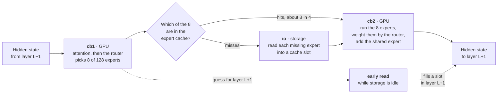

# How the engine works

This page explains how Localita runs a 26-billion-parameter model on an
iPhone that gives an app about 4 GB of memory. It is written for a curious
developer, not as a reference. The reference is
[`SYSTEM_DESIGN.md`](SYSTEM_DESIGN.md), with a code map, and
[`RUNTIME_CONTROLS.md`](RUNTIME_CONTROLS.md) lists every setting.

The engine is TurboFieldfare, by [drumih](https://github.com/drumih/turbo-fieldfare),
built for 8 GB Macs. This repository ported it to the iPhone and made it
faster there. [`WHAT_LOCALITA_ADDS.md`](WHAT_LOCALITA_ADDS.md) says which
parts are which.

Unless a line says otherwise, the numbers are from an iPhone 17 (8 GB,
iOS 26.6) running the app's own benchmark at default settings on 2026-10-13
([`results/validation-results-2026-10-13-ios-in-app-benchmark/`](../results/validation-results-2026-10-13-ios-in-app-benchmark/results.md),
second run). The three columns are always the short, medium and long
benchmark prompts.

## The problem

Gemma 4 26B-A4B is about 14.3 GB once quantized to 4 bits. An iPhone 17 has
8 GB of memory, and iOS will not let one app use most of it. With the
increased-memory-limit entitlement, the app is killed from about 5.6 GB, and
it starts pushing other apps out of memory well before that. The project
budgets against about 4.3 GB.

The model cannot be in memory. Most of it has to stay on storage and be read
as it is needed.

## Why that is possible: mixture of experts

Each of the model's 30 layers has an attention block and a feed-forward
block. In this model the feed-forward block is split into 128 small networks
called *experts*, plus one *shared expert* that always runs. For every token,
a small *router* in each layer scores the 128 experts and picks 8. The other
120 do nothing for that token.

So although the model has 26 billion parameters, one token touches only about
3.9 billion. Everything except the routed experts is needed for every token
and stays in memory. The routed experts are most of the model's bytes, and
each token needs only 8 of 128 per layer.

| Part | Size | Where it lives |
| --- | --- | --- |
| Shared weights: embeddings and output head, attention, routers, shared experts, norms | 1.35 GB | Memory-mapped from one file. Read-only mapped pages count almost nothing against the app's limit: 1.26 GiB of them cost about 16.6 MB. |
| Routed experts: 30 layers × 128 experts, 3,358,720 bytes each | 12.01 GiB | 30 files on storage, one per layer. Read on demand. |
| Expert cache: 24 slots per layer | about 2.4 GB | App memory. Holds experts already read. |
| Attention cache (KV), FP16 | about 305 MiB at 4K context, plus 152 MB for 1,024-token prefill chunks | App memory. |

The app runs at about 3.1–3.4 GB at its peak in the benchmark.

## One token, layer by layer

Producing a token means running all 30 layers in order. Each layer is three
steps, and the engine's logs name them:

1. **`cb1`, on the GPU.** Normalize, project to queries, keys and values,
   apply rotary position, write the keys and values into the attention cache,
   attend, project back, and run the router. The CPU waits until the 8 chosen
   expert numbers can be read.
2. **`io`, storage.** The CPU checks the layer's expert cache. For every
   expert not in it, it reads that expert's 3.36 MB straight from the layer
   file into a slot that the GPU can already see, with no copy. The GPU runs
   the shared expert in the meantime, because it does not depend on the
   router.
3. **`cb2`, on the GPU.** Run the 8 routed experts, mix their outputs by the
   router's weights, add the shared expert, and finish the layer.

After layer 30, the output head turns the hidden state into scores over the
vocabulary, and the sampler picks the next token.

The GPU kernels are written for this model in Metal: 4-bit and 8-bit
matrix-vector products for decode, and Apple's matrix units for the large
matrix products in prefill. There is no MLX or llama.cpp underneath.

## The expert cache

Each layer keeps its own cache of 24 expert slots. When a token needs an
expert that is not cached, the engine evicts the one used least often and
reads the new one in. Every count is multiplied by 0.97 each time the layer
plans a token, so experts that were popular in an earlier conversation fade
out.

Routing is not random. Neighbouring tokens tend to reuse experts, so a small
cache catches most of them:

| | short | medium | long |
| --- | --- | --- | --- |
| Hit rate | 79.5% | 75.9% | 73.7% |
| Experts requested per token | 240 | 240 | 240 |
| Reads per token, early reads included | 58.95 | 66.13 | 70.88 |
| Bytes read per token, MiB | 188.84 | 211.83 | 227.02 |

Without any cache, each token would read 806.1 MB (30 layers × 8 experts ×
3,358,720 bytes). The cache cuts that to between a quarter and a third. More
slots catch more, but each 8 extra slots per layer cost about 0.8 GB of
memory. 32 slots were faster but left too little room for the rest of the
phone, such as the photo picker, so the default is 24.

## Reading ahead: the early expert read

Storage on the phone reads one expert at a time, at about 2 ms each. Two
reads issued together only slow each other down. While the GPU runs `cb2`
and the next layer's `cb1`, storage sits idle for about 1.9–2.5 ms per layer.

The early read fills that gap. Once a layer's own reads are done, the engine
guesses which expert the *next* layer will want, and reads it. The guess runs
a copy of the next layer's router, refitted offline on recorded routing (an
11.1 MB file shipped with the app), on the current layer's input. It is right
about 68–75% of the time. If the guess is right, the next layer has one read
fewer to wait for. If it is wrong, the read cost little, because storage was
idle.

It reads more bytes, about 11–18% more per token, and is still about 17–20%
faster, because those extra bytes are read while nothing else is happening.
A second early read per layer was tried and is slower on the phone, because
one read already fills the idle window.

## Reading a prompt: prefill

Before it can reply, the model has to read the whole prompt. Doing that one
token at a time would read experts for every token. Instead, prefill goes
layer by layer over chunks of up to 1,024 tokens. For each layer, it reads
every expert that any token in the chunk chose, at most 8 at a time, and runs
all of the chunk's tokens through it.

A long chunk touches most of the experts. The long prompt, 3,015 tokens, runs
as three chunks and read 30,606 MiB in prefill: about 106 of each layer's 128
experts per chunk. Raising the chunk size on iOS from 256 to 1,024 tokens cut
that prompt's prefill reads by 70.6%.

## Where a token's time goes

Milliseconds per token, from the engine's own timers:

| | short | medium | long |
| --- | --- | --- | --- |
| Whole token | 159.4 | 178.6 | 191.2 |
| `io`: waiting for expert reads | 93.7 (59%) | 91.4 (51%) | 110.5 (58%) |
| `cb1` wait: attention and router on the GPU, plus handoffs | 49.8 (31%) | 68.9 (39%) | 64.2 (34%) |
| Output head | 9.1 | 10.8 | 9.4 |
| GPU idle, from GPU timestamps | 96.2 (60%) | 93.9 (53%) | 113.7 (59%) |

Waiting for storage is still the largest part of every token. The GPU is idle
for more than half of it. That is the main open lever: keep storage and the
GPU busy at the same time. [`AGENTS.md`](../AGENTS.md#where-the-time-goes-on-the-phone)
tracks this breakdown and the levers being worked on.

## Keeping the output right

A faster engine that changes the model's answers is not the goal. Every GPU
kernel is tested against a plain CPU implementation of the same math. On the
iPhone 17's GPU, 179 such tests pass, with the same worst-case error as on the
Mac.

Speed changes that should not change the math are checked against the
generated text itself. A benchmark prompt with a fixed seed gives the same
text every time, so the run logs its SHA-256. The early read, skipping the OS
file cache, and cache aging all produced byte-identical text to the runs
without them. Changes that would trade quality for speed, such as fewer
experts per token, stay opt-in experiments and are measured for quality.

## Read next

- [`SYSTEM_DESIGN.md`](SYSTEM_DESIGN.md): the full design, the file format,
  load and ownership rules, and the code map.
- [`IOS_PORT.md`](IOS_PORT.md): how the engine was brought to the iPhone, in
  order, with what was measured at each step.
- [`experiments/summaries/`](experiments/summaries/): every optimization tried,
  kept or dropped, and why.
- [`MEASUREMENTS.md`](../MEASUREMENTS.md): every recorded run.
